

<picture><source media="(prefers-color-scheme: dark)" srcset="assets/hero-dark.svg"></picture>

<picture><source media="(prefers-color-scheme: dark)" srcset="assets/social-l-dark.svg"></picture><a href="https://t.me/sangsdayy"><picture><source media="(prefers-color-scheme: dark)" srcset="assets/social-1-dark.svg"></picture></a><a href="https://discord.com/users/926519119849869322"><picture><source media="(prefers-color-scheme: dark)" srcset="assets/social-2-dark.svg"></picture></a><a href="https://x.com/sengsdeyy"><picture><source media="(prefers-color-scheme: dark)" srcset="assets/social-3-dark.svg"></picture></a><a href="https://youtube.com/@sang765"><picture><source media="(prefers-color-scheme: dark)" srcset="assets/social-4-dark.svg"></picture></a><picture><source media="(prefers-color-scheme: dark)" srcset="assets/social-r-dark.svg"></picture>

<picture><source media="(prefers-color-scheme: dark)" srcset="assets/about-dark.svg"></picture>

<picture><source media="(prefers-color-scheme: dark)" srcset="assets/stack-dark.svg"></picture>

<a href="https://github.com/sang765/Anicord-Theme"><picture><source media="(prefers-color-scheme: dark)" srcset="assets/project-anicord-theme-dark.svg"></picture></a>&nbsp;<a href="https://github.com/sang765/Discord-CSS-Snippets"><picture><source media="(prefers-color-scheme: dark)" srcset="assets/project-discord-css-snippets-dark.svg"></picture></a>

<a href="https://github.com/sang765/DARK-Launcher-Open"><picture><source media="(prefers-color-scheme: dark)" srcset="assets/project-dark-launcher-open-dark.svg"></picture></a>&nbsp;<a href="https://github.com/sang765/PaperMC-Manager"><picture><source media="(prefers-color-scheme: dark)" srcset="assets/project-papermc-manager-dark.svg"></picture></a>

<picture><source media="(prefers-color-scheme: dark)" srcset="assets/stats-dark.svg"></picture>

<picture><source media="(prefers-color-scheme: dark)" srcset="assets/streak-dark.svg"></picture>

<picture><source media="(prefers-color-scheme: dark)" srcset="assets/wave-dark.svg"></picture>

<a href="https://github.com/sang765?tab=repositories"><picture><source media="(prefers-color-scheme: dark)" srcset="assets/button-1-dark.svg"></picture></a>

<a href="https://metawka.github.io/expressive-profile/?from=sang765"><picture><source media="(prefers-color-scheme: dark)" srcset="assets/credit-dark.svg"></picture></a>

